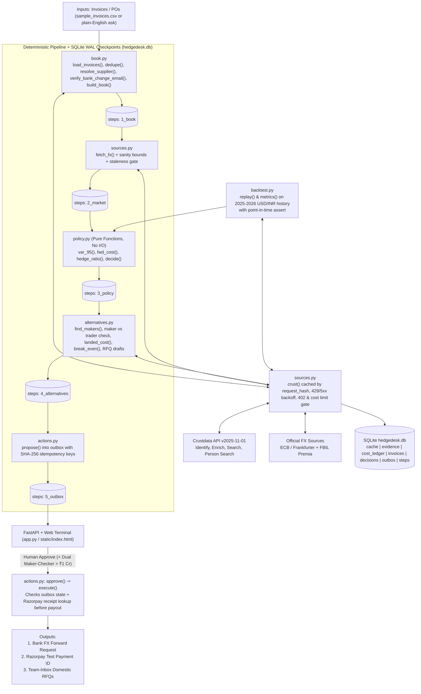

# HedgeDesk Architecture (`ARCHITECTURE.md`)

> One cached source layer feeds every decision; one outbox executes it.

## Module Map (Matches Context Doc Specification)

| File | Responsibility |
| :--- | :--- |
| `policy.yaml` | Board-approved tenor ranges (`0-1m`, `1-3m`, `3-6m` × `confirmed`/`forecast`), `k=3.0`, maker-checker threshold, sanity bounds, cost ceiling. |
| `sources.py` | Single external gateway (`crust()`, `fetch_fx()`, `evidence()`), SQLite `hedgedesk.db` 7-table schema, SHA-256 cache, `429`/`402` handling. |
| `book.py` | Parses CSV/messy text (`"USD 1.2 lakh"`), resolves suppliers via Crustdata, checks bank-detail change emails via `Person Search`, links duplicates via `dup_of`. |
| `policy.py` | Zero-I/O pure math (`var_95`, `fwd_cost`, `hedge_ratio`, `decide`) with point-in-time `assert`. |
| `alternatives.py` | Finds Indian manufacturers via `Company Search`, filters `TRADER` vs `MAKER`, computes break-even `₹/unit`, marks prices `"cannot verify, RFQ drafted"`. |
| `actions.py` | `drafted` -> `approved` -> `sent`/`paid` outbox state machine, dual approval gate, Razorpay test receipt lookup (`Case 24*`). |
| `backtest.py` | Point-in-time replay on 18 months of daily USD/INR data (`2025-04-30` to `2026-11-20`) vs 3 baselines. |
| `engine.py` | Crash-resilient orchestrator reading/writing SQLite `steps` checkpoints. |
| `app.py` & `static/index.html` | Interactive web console, CSV upload, `policy.yaml` live editor, Kill-on-Stage simulator, and Approval Queue. |
