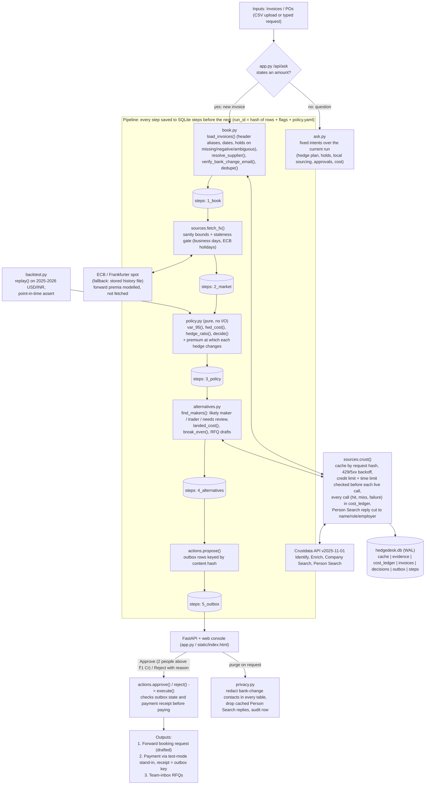
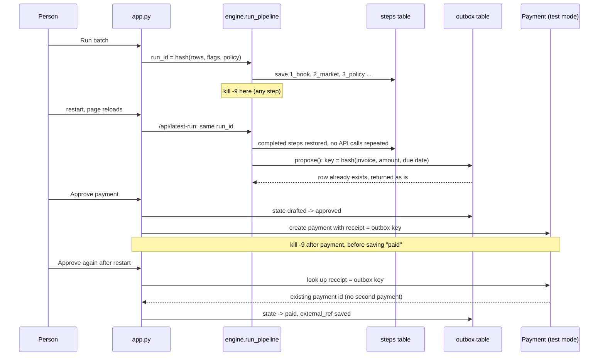

# HedgeDesk Architecture (`ARCHITECTURE.md`)

> One cached source layer feeds every decision; one outbox executes it.

## Kill and restart: why each action happens once

The same key rule covers re-runs: running the same invoices again, or under an edited policy, proposes the same payment key, finds the existing row (drafted, paid or rejected) and leaves it alone.

## Module map

| File | Responsibility |
| :--- | :--- |
| `policy.yaml` | Tenor ranges (`0-1m`, `1-3m`, `3-6m` × confirmed/forecast), `k`, VaR confidence, dual-approval threshold, staleness limit, sanity bounds, per-run credit and time limits, default duty and freight. |
| `sources.py` | Only file that calls outside services: `crust()`, `fetch_fx()`, evidence and cost ledgers, SQLite schema, run clock, Person Search minimising. |
| `book.py` | Reads CSV, typed or messy amounts and dates, maps common headers, resolves suppliers on Crustdata, checks bank-detail change requests, links duplicates. |
| `policy.py` | Pure maths (`var_95`, `fwd_cost`, `hedge_ratio`, `decide`) with the point-in-time assert; every hold has its own reason and clause. |
| `alternatives.py` | Indian maker search, keyword maker/trader/needs-review split, break-even ₹/unit, prices always "cannot verify, RFQ drafted". |
| `actions.py` | Outbox state machine (`drafted` → `approved` → `sent`/`paid`, or `held` / `rejected`), dual approval, receipt lookup before paying. |
| `ask.py` | Answers questions about a finished run from its own decisions and evidence; unknown questions get "cannot answer". |
| `privacy.py` | Summary of personal data held, purge per supplier domain or all, with an audit record. |
| `backtest.py` | Point-in-time replay on daily USD/INR (`2025-04-30` to `2026-11-20`) against never / 50% / 100% hedging. |
| `engine.py` | Runs the five steps, saving each to `steps`; starts the per-run clock. |
| `app.py`, `static/index.html` | Web console: runs, CSV upload, questions, policy editor, simulation toggles, approval queue, evidence and cost ledgers. |
